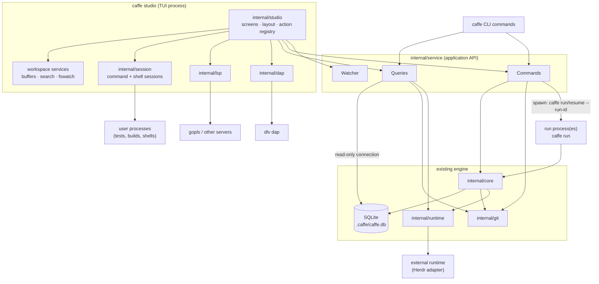
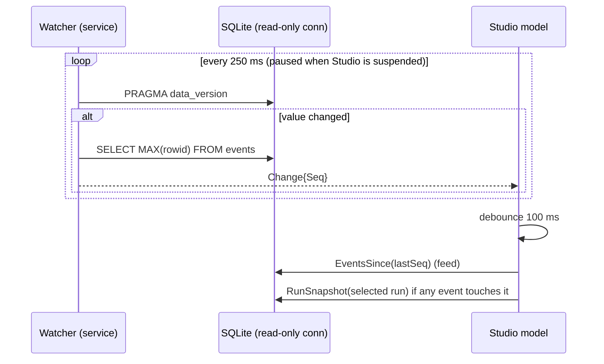
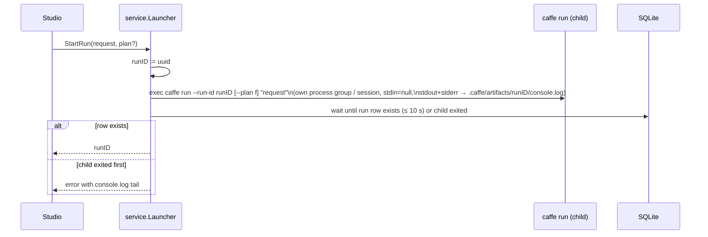
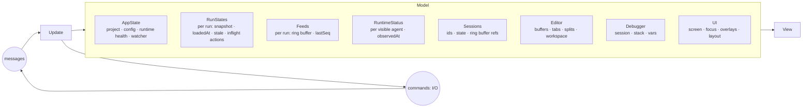
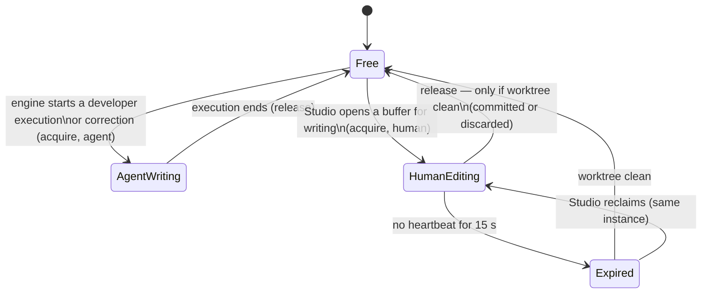

# Caffè Studio — Architecture

Status: **Proposed.** Builds on the existing engine described in
[../architecture.md](../architecture.md) and audited in [audit.md](audit.md).
Technology choices are argued in [technical-decisions.md](technical-decisions.md)
(ADR-*n*).

---

## 1. Principles applied

1. **The engine is not touched for the UI's convenience.** Scheduling, the task
   lifecycle, recovery and the runtime contract stay as they are. The core
   changes listed in §11 are small, additive and justified independently of
   the UI.
2. **SQLite is the integration point.** Caffè is already multi-process
   (heartbeat ownership, cross-process cancel). Studio is one more process
   that reads the database and asks the engine to act.
3. **Studio never acts directly** on the database, the runtime or managed
   worktrees: it calls the application API.
4. **Runs outlive Studio.** A run started from Studio is a separate `caffe`
   process.

## 2. System overview



## 3. Package boundaries

| Package | Status | Responsibility | May import |
|---|---|---|---|
| `internal/contracts`, `core`, `persistence`, `git`, `runtime`, `runtime/herdr`, `agents`, `planner`, `config` | Implemented | the engine | unchanged |
| `internal/service` | Proposed | application API: queries, commands, change watcher, run launcher, view types | engine packages |
| `internal/app` | Implemented → changed | CLI wiring; commands call `service` instead of `Store`/`RT` | `service`, `config` |
| `internal/studio` | Proposed | Bubble Tea program: model, screens, layout, theme, action registry, key maps | `service`, `session`, `workspace`, `lsp`, `dap` — **never** `persistence`, `core`, `runtime`, `git` |
| `internal/studio/workspace` | Proposed | buffers, file loading/saving, highlighting cache, search (via `rg`), file watching | `service` (for workspaces, leases, safe paths) |
| `internal/session` | Proposed | process sessions: command (pipes) and shell (PTY / hand-off), process groups, ring buffers | stdlib, PTY library |
| `internal/lsp` | Proposed | generic LSP client, server registry, document sync, diagnostics store | JSON-RPC library |
| `internal/dap` | Proposed | generic DAP client, debug session lifecycle | DAP protocol types |

An import-boundary test (`go list -deps`) fails the build if
`internal/studio/...` imports an engine package directly.

`internal/session`, `lsp` and `dap` are independent of Studio's UI so they can
be tested headless and reused.

## 4. Application API (`internal/service`)

One `Service` value, created from a project root, holding the config, a
**read-only** store connection, the Git manager and the runtime adapter. The
CLI and Studio use the same type.

```go
// Queries never modify state.
type Queries interface {
    Project(ctx) (ProjectInfo, error)                       // root, config summary, base branch
    Runs(ctx, RunFilter) ([]RunSummary, error)
    RunSnapshot(ctx, runID string) (*RunSnapshot, error)    // one read transaction, see §5.2
    EventsSince(ctx, after int64, f EventFilter, limit int) ([]Event, error)
    Execution(ctx, executionID string) (*ExecutionDetail, error)
    ReadArtifact(ctx, artifactID string, max int64) (ArtifactContent, error) // bounded, redacted text
    Report(ctx, runID string) (string, error)               // core.BuildReport
    AgentOutput(ctx, agentID string, lines int) (AgentOutput, error)        // live or captured, labelled
    AgentRuntimeStatus(ctx, agentIDs []string) (map[string]RuntimeStatus, error)
    Capabilities(ctx) (*RuntimeInfo, error)
    Workspaces(ctx) ([]Workspace, error)                    // main + existing task worktrees + lease holders
    TaskDiff(ctx, taskID string) (Diff, error)              // stored artifact, or live git diff vs base
    ResolvePath(ctx, workspaceID, p string) (string, error) // safe path inside a workspace (NFR-S2)
}

// Commands change state, always through the engine.
type Commands interface {
    StartRun(ctx, StartRunRequest) (runID string, err error) // detached process, §6
    ResumeRun(ctx, runID string) error                       // detached process
    CancelRun(ctx, runID string) (*RunSummary, error)        // core.Orchestrator.Cancel
    Clean(ctx, CleanRequest) ([]string, error)               // core.Orchestrator.Clean
    AttachAgent(ctx, agentID string) (*exec.Cmd, error)      // runtime Attacher capability, §8.4
    AcquireLease(ctx, workspaceID string, holder Holder) (*Lease, error) // §9
    RenewLease(ctx, *Lease) error
    ReleaseLease(ctx, *Lease) error                          // refuses if worktree dirty, §9
    CommitManual(ctx, workspaceID, message string, files []string) (string, error)
}

// Watcher reports that persisted state changed, without saying what.
type Watcher interface {
    Changes(ctx) <-chan Change // Change{Seq int64}: highest event seq seen
}
```

View types (`RunSummary`, `RunSnapshot`, `TaskView`, `AgentView`,
`ExecutionDetail`, `Workspace`, …) are plain structs defined in `service`.
They include derived fields computed **once, in Go, testable**: the reason a
task is waiting (from `core.Graph.Waiting`), the agent visual state
([ux-specification.md §4.1](ux-specification.md#41-agent-visual-state)),
elapsed times, and whether a result is observed or claimed.

Errors are typed: `service.ErrNotFound`, `ErrConflict` (state changed
underneath; the caller refreshes), `ErrUnavailable` (runtime/database),
`ErrLeaseHeld`, `ErrDirty`, `ErrUnsupported` (runtime capability missing).

## 5. Event model

### 5.1 Today

Events are rows in `events` (UUID id, `run_id`, `task_id`, `agent_id`, `type`,
JSON `payload`, `created_at`). Task and run transitions write their event in
the same transaction as the state change; other events are written separately
(`Orchestrator.event`). Some state changes have no event (agent rows,
execution start, artifacts). There is no cursor. See [audit.md §2](audit.md#2-missing-capabilities-studio-needs).

### 5.2 Proposed: snapshot is truth, events are the feed

Studio does **not** rebuild state by folding events (no event sourcing). The
tables are the state; events are (a) the human-readable activity feed and (b)
the trigger to re-read.

Smallest set of changes (all in `persistence`, no schema rebuild):

1. **Cursor.** `Event.Seq` = SQLite `rowid` of `events`. It is monotonic
   because events are append-only: no code path deletes from any table
   (verified: no `DELETE` statement; `ON DELETE CASCADE` is never triggered).
   A test asserts that `Seq` increases with insertion order, and a code-review
   rule forbids deleting events. *If retention is ever needed, migrate to an
   explicit `seq INTEGER PRIMARY KEY AUTOINCREMENT` table at that point.*
2. **`EventsSince(after, filter, limit)`**: `WHERE rowid > ? ORDER BY rowid
   LIMIT ?`, optionally by `run_id`.
3. **Missing events**, in the same transaction as their row:
   `agent.started`, `agent.stopped`, `execution.started`, `artifact.added`.
4. **Typed event names**: constants in `contracts` (`EventTaskTransition`,
   …) and a documented payload per type; existing names unchanged.
5. **Read-only connection** for consumers: `mode=ro`, `_txlock=deferred`,
   separate from the writer pool (the writer's `_txlock=immediate` would make
   a read transaction take the write lock).
6. **`RunSnapshot`** reads run, tasks, dependencies, agents, executions,
   artifacts and `MAX(rowid) FROM events` **in one read transaction** — a WAL
   snapshot, so it is consistent even while a run process writes.

### 5.3 Change detection



`PRAGMA data_version` changes when *another* connection commits; reading it is
a cheap local check, not a query over data. It is "polling" only in the sense
of a timer; real reads happen only on change. (**Investigate** in M0: measure
its cost under `modernc.org/sqlite` with WAL; fallback is watching the
`caffe.db-wal` file with fsnotify.) Actions performed by Studio itself trigger
an immediate refresh without waiting for the tick.

### 5.4 Guarantees

| Requirement | How |
|---|---|
| Initial state | `RunSnapshot` + `Runs` |
| Incremental updates | `EventsSince(lastSeq)` on change |
| No duplicates | a snapshot carries the `Seq` it reflects; events with `Seq ≤ snapshot.Seq` are already in it; the feed keeps `lastSeq` |
| Replay | the feed of any run can be reloaded from seq 0 (bounded pages) |
| Reconnection / restart | Studio keeps no persistent cursor; it starts from a fresh snapshot. Nothing is lost because the tables are complete. |
| Events written outside a transaction lost in a crash | harmless for state (tables are truth); the feed may miss one line |
| Multiple views | one model, one snapshot per run in memory; views are pure functions of it |
| Bounded memory | snapshots only for the selected run and runs on screen; feed ring buffer of 2 000 events per run, older pages loaded on scroll |

## 6. Run hosting

`Orchestrator.Run` blocks for the whole run and its lifetime is its process.
Studio must not host it (W8). Instead `Commands.StartRun`:



- `--run-id` (new, validated UUID) makes the id known before the process
  starts; a duplicate id fails `CreateRun` (primary key).
- The child is started in its own session (`setsid` on Unix,
  `CREATE_NEW_PROCESS_GROUP` on Windows) so closing Studio or its terminal
  does not signal it.
- Cancellation already works across processes (`Orchestrator.Cancel`); resume
  uses the same launcher with `caffe resume`.
- The CLI's interactive `caffe run` is unchanged.

## 7. State management (Studio)

Bubble Tea's Elm-style loop: one model, messages in, `Update` returns the new
model and commands; **all I/O runs in commands**, never in `Update` or `View`
(NFR-P1).



| State | Source of truth | Refresh |
|---|---|---|
| Application | config file, `Capabilities` | on start; runtime health every 10 s |
| Run / task / agent / execution | database (`RunSnapshot`) | on change notification |
| Runtime session status | runtime adapter (`AgentRuntimeStatus`) | only for agents on screen, every 2 s; never written anywhere |
| Live agent output | runtime adapter (`AgentOutput`) | only for the focused agent, every 1 s |
| Terminal sessions | `internal/session` (in-memory, Studio lifetime) | pushed via `Program.Send` |
| Editor | files on disk + in-memory buffers | file watcher marks buffers changed-on-disk |
| Debugger | DAP adapter | events from the adapter |

Rules:

- **Stale data** keeps its last good value, marked with `loadedAt`; a failed
  refresh sets `stale` and the view shows "stale since …". Retries back off
  (1 s → 30 s).
- **Concurrent operations**: an action marks its target `inflight` (the action
  is disabled and shows a spinner in text); the result triggers a refresh.
  `ErrConflict` means someone else changed it first: Studio says so and
  refreshes, never retries blindly.
- **Selection by id**: lists keep the selected id across refreshes.
- **Runtime status is advisory**: it decorates agent cards; decisions (what is
  completed, failed) come only from the database.

## 8. Terminal and execution architecture

### 8.1 Session kinds

| Kind | Purpose | Mechanism | Milestone |
|---|---|---|---|
| **Command** | tests, builds, validation, any argv | pipes, no PTY; argv only (no shell); output to ring buffer + log file | M3a |
| **Hand-off shell / editor** | interactive shell, `$EDITOR`, runtime attach | Studio suspends and gives the whole terminal to the child; resumes on exit (ADR-004) | M2a/M3a |
| **Embedded shell** | interactive shell inside a pane | PTY + terminal emulator (ADR-004) | M3b, **Investigate** |
| Agent session | an agent's terminal | **not a Studio session**: owned by the external runtime, shown read-only in the Agent Room or via attach | — |

### 8.2 Command sessions

- Started in the selected workspace with an argv (the user types a command
  line; it is split like `validation.commands`; a shell is used only if the
  user explicitly chooses "run in shell", which is a hand-off or embedded
  shell, never `sh -c` on agent-provided text).
- Own process group (`Setpgid` on Unix; a kill-on-close job object on
  Windows, W-03). Stop = SIGTERM to the group, SIGKILL after 3 s.
- Output: a reader goroutine per stream → line splitter → bounded ring
  buffer (10 000 lines) + `.caffe/studio/sessions/<id>.log`; the UI gets
  batched `OutputAppended` messages (≤ 20/s).
- `file:line[:col]` patterns in output are detected by a pure function and
  resolved through `ResolvePath` before they become links.

### 8.3 Lifetime and cleanup

All sessions live for Studio's lifetime. On quit: confirm if any are running;
then terminate groups, wait, kill; close PTYs; restore the terminal. A
`defer`+`recover` path and a signal handler (`SIGINT`, `SIGTERM`, `SIGHUP`)
run the same cleanup (NFR-R3/R4).

### 8.4 Agent attach

A new **optional** runtime interface, discovered by type assertion so the
`Runtime` contract is unchanged:

```go
// in internal/runtime
type Attacher interface {
    // AttachCommand returns the argv that connects the user's terminal to the
    // agent's terminal. The caller runs it with the terminal handed over.
    AttachCommand(agent string) ([]string, error)
}
```

The Herdr adapter implements it (`herdr [--session S] agent attach NAME`).
Studio runs it as a hand-off. Runtimes without it show "attach not supported
by this runtime".

## 9. Worktree integration

### 9.1 Workspaces

```go
type Workspace struct {
    ID       string // "main" or the task id
    Kind     string // "main" | "task"
    Path     string
    Branch   string
    Base     string // diff base (commit) — same rule as the engine's diffBase
    RunID, TaskID, TaskKey string
    TaskStatus contracts.TaskStatus
    Lease    *Lease // current holder, if any
    Dirty    bool
}
```

Built from `tasks.worktree_path`/`branch_name` joined with
`git.Manager.ListWorktrees` (a worktree recorded in the database but missing on
disk is shown as "removed"). The diff base rule now lives in
`session.diffBase` (unexported, in-run); it is moved to an exported function in
`core` that works from persisted state, used by both the engine and
`TaskDiff`.

### 9.2 Ownership: the worktree lease

Today's lock is in-memory (`Orchestrator.wtLock`) and `collectChanges` commits
everything it finds. Human edits need a cross-process contract.

New table (migration `002`):

```sql
CREATE TABLE worktree_leases (
  path         TEXT PRIMARY KEY,
  holder_kind  TEXT NOT NULL,      -- 'agent' | 'human'
  holder_id    TEXT NOT NULL,      -- execution id | studio instance id
  run_id       TEXT NOT NULL DEFAULT '',
  task_id      TEXT NOT NULL DEFAULT '',
  acquired_at  TEXT NOT NULL,
  heartbeat_at TEXT NOT NULL
);
```



Rules:

1. Acquire is an `INSERT … ON CONFLICT DO NOTHING` / compare-and-swap; only
   one holder.
2. **Engine**: before a developer execution or correction writes, it acquires
   an agent lease. If a human holds it (or an expired human lease remains with
   a dirty worktree), the task the scheduler dispatched goes `running →
   blocked` with the reason "worktree held by a manual edit session" and
   retries every poll interval (existing `blocked → running`). For a first
   developer execution the task is still `assigned` at that point, and
   `assigned → blocked` is not in today's transition table: the engine must
   either mark the task `running` before acquiring, or the table gains that
   edge. Recommended: mark `running` first (no state-machine change). For a
   correction, the dispatched task is the reviewer, which is already
   `running`. This is the only engine behaviour change, and it only triggers
   when a human lease exists.
3. **Studio**: buffers in a task worktree open read-only unless the human
   lease is acquired. Writes are refused while an agent holds it (FR-W9).
4. **Release requires a clean worktree.** Manual changes must be committed
   (`CommitManual`, authored by the user's Git identity, message prefixed
   `manual:`) or discarded (confirmed). Therefore `collectChanges` can never
   sweep human edits into an agent's commit.
5. The main checkout has no lease: Caffè never writes there.
6. Cleanup (`caffe clean`) skips worktrees with any lease and, as today, dirty
   worktrees.

### 9.3 Visibility

- The selected workspace is in the header and status bar, always.
- The explorer marks files changed relative to the task base (`M`, `A`, `D`)
  and files changed relative to the last agent commit (manual edits, `●`).
- Opening a file from a diff, an error or a report opens it **in the workspace
  it came from**; if that is not the selected workspace, Studio asks before
  switching.
- Changes are never copied between worktrees by Studio.

## 10. Editor architecture

See ADR-003 for the choice. Structure, independent of the widget:

- **Buffer**: path (resolved, inside a workspace), workspace id, content
  (line slice or rope, behind an interface), `dirty`, the on-disk mtime and
  SHA-256 at load, undo stack, read-only reason.
- **Save**: refuse if not leased (task worktree) or if the file changed on
  disk since load (offer reload/overwrite, confirmed); write to a temp file in
  the same directory and rename.
- **Highlighting**: Chroma tokenises per buffer; results cached per line
  range; only the visible region is rendered (NFR-P4).
- **Search**: in-buffer search in Go; workspace search via `rg --json`
  (fallback: Go walker with `.gitignore` support limited to the root file).
- **File watching**: fsnotify on open files' directories only (no recursive
  watch of the repository).
- **External editor**: `e` hands off to `$VISUAL`/`$EDITOR` with `+<line>`
  where supported; on return, the buffer reloads if the file changed.

## 11. LSP and DAP boundaries

### 11.1 LSP (`internal/lsp`)

```go
type ServerConfig struct { Language string; Command []string; RootMarkers []string; InitOptions json.RawMessage }
type Manager interface {
    For(ctx, workspace Workspace, language string) (Client, error) // lazy start
    Shutdown(ctx) error
}
type Client interface {
    DidOpen(uri, lang, text string, version int) error
    DidChange(uri string, version int, text string) error // full sync first
    DidClose(uri string) error
    Definition(ctx, uri string, pos Position) ([]Location, error)
    References(ctx, uri string, pos Position) ([]Location, error)
    DocumentSymbols(ctx, uri string) ([]Symbol, error)
    Diagnostics() <-chan PublishDiagnostics
}
```

- One server per (language, workspace root). Each task worktree is a separate
  root, so a second `gopls` per worktree; the manager caps live servers
  (default 3) and shuts down the least recently used.
- Lifecycle: `initialize` → `initialized` → … → `shutdown` → `exit`; kill
  after 5 s.
- Server crash: diagnostics cleared and marked unavailable; restart on next
  request with backoff.
- Go defaults: `gopls`, root marker `go.mod`. Other languages are config only.

### 11.2 DAP (`internal/dap`)

```go
type AdapterConfig struct { Name string; Command []string; Transport string } // Delve: dlv dap
type Session interface {
    Launch(ctx, LaunchRequest) error            // mode: debug | test | exec
    SetBreakpoints(file string, lines []int) ([]Breakpoint, error)
    Continue(threadID int) error; Next(threadID int) error; StepIn(threadID int) error; StepOut(threadID int) error
    StackTrace(threadID int) ([]Frame, error)
    Scopes(frameID int) ([]Scope, error); Variables(ref int) ([]Variable, error)
    Events() <-chan Event                       // stopped, output, terminated
    Disconnect(terminate bool) error
}
```

Debug sessions run in a selected workspace; the debuggee is a child of the
adapter, which is a Studio session (process group, cleanup as §8.3).

## 12. Error handling

| Failure | Behaviour |
|---|---|
| Database locked/busy | read connection has `busy_timeout`; a failure marks views stale and backs off |
| Database missing / not a Caffè project | full-screen state, no crash |
| Runtime unavailable | header indicator; live features disabled with the adapter's message; stored data still shown |
| Command failed (`service.Err*`) | toast + event panel entry; state refreshed |
| Child process failed to start | session shows the error and exit code −1 |
| LSP/DAP server crash | feature marked unavailable, restart on demand |
| Panic in Studio | terminal restored, sessions cleaned, panic written to `.caffe/studio/crash-<ts>.log`; runs unaffected |

Studio writes its own log to `.caffe/studio/studio.log` (zerolog JSON, like
`caffe.log`), redacted.

## 13. Lifecycle

**Startup**: find project root → load and validate config → open read-only
store → (in background) runtime capabilities → load runs → select the most
recent active run → start watcher.

`caffe studio` opens the project like every `caffe` command, which runs
`Orchestrator.Recover`: runs whose owner stopped heartbeating are flagged
interrupted before the first screen, so Studio shows them correctly. It is
idempotent and touches no running run.

**Suspend/resume** (hand-off): stop watcher ticks and output pumps → release
the terminal → run child → restore → refresh everything.

**Shutdown**: block if unsaved buffers; confirm if sessions run → stop
watcher → terminate sessions → LSP `shutdown`/`exit` → DAP `disconnect` →
release clean human leases (dirty ones stay and are reported) → restore
terminal. Run processes are not touched.

## 14. Configuration

Studio settings go in a new `studio:` section of `.caffe/config.yaml`
(validated strictly like the rest): `theme`, `mouse`, `reduce_motion`,
`avatars`, `editor` (overrides `$EDITOR`), `lsp.servers`, `dap.adapters`,
`sessions.buffer_lines`. Defaults make the section optional.

## 15. Testing strategy

- `service`: integration tests on a real SQLite + Git repo + `runtime.Fake`
  (same harness style as `core/orchestrator_test.go`); a cross-process test
  where a writer goroutine on its own connection commits while snapshots are
  read (consistency).
- `studio`: model tests drive `Update` with messages and assert on the model
  and on rendered `View` strings at fixed sizes (golden files);
  program-level end-to-end tests with a `teatest`-style helper if one exists
  for Bubble Tea v2 (**unverified**, checked in F-17), otherwise by driving
  `Update` directly.
- `session`: real child processes (`sleep`, `sh -c` in tests only),
  process-group kill, no orphan check via `/proc` on Linux.
- `lsp`/`dap`: fake servers speaking JSON-RPC over pipes; optional real
  `gopls`/`dlv` tests behind an env flag, like `make e2e`.
- Import-boundary test for `internal/studio`.
