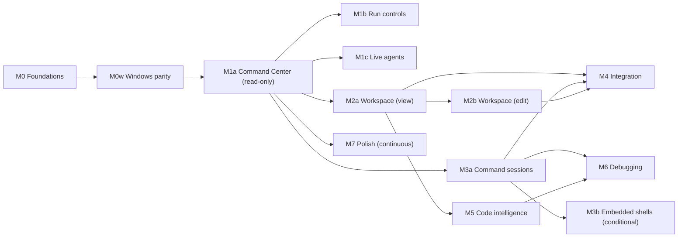

# Caffè Studio — Roadmap

Status: **Delivered** through M6 (2026-11-19). Open: M3b embedded shells
(spike EX-07 passed on Linux; blocked on a Windows run), the M7 polish items
PO-01 to PO-06, and the manual Windows checks F-17, W-04 and W-06 (the
[Windows kit](../../scripts/windows/README.md)). Effort is relative
(S < M < L < XL), not calendar time. Task ids refer to [backlog.md](backlog.md).

---

## 1. Ordering rationale

The proposed milestone list was adjusted on three repository findings
([audit.md](audit.md)):

1. **No application layer exists** (W1) and **events cannot be consumed
   incrementally** (W3). Any UI built before fixing that would read SQLite
   directly. → **M0 is mandatory** and is mostly engine-adjacent work.
2. **Runs must outlive Studio** (W8). Run control in M1 depends on the
   detached launcher from M0.
3. **The engine produces branches but nothing helps decide what to do with
   them.** That is the human-in-the-loop gap closest to the product's purpose,
   and it needs only M2a (diffs) and M3a (running tests). → a new
   **Integration** milestone moves ahead of LSP and debugging.

Each milestone is split into increments that ship on their own.

Priorities: **P0** = M0, M0w, M1a, M1b, M2a · **P1** = M1c, M3a, M2b, M4 ·
**P2** = M5, M6, M3b, M7.

## 2. Milestones

### M0 — Foundations · effort L · P0

1. **Objective.** Give consumers a correct, incremental, consistent view of
   the engine, and a way to start runs that outlive the caller.
2. **User value.** None visible on its own except a CLI that keeps working;
   it removes the risk that Studio is built on direct database access.
3. **Capabilities.** Application API (queries + commands); event cursor and
   missing events; consistent snapshots; change watcher; detached launcher;
   live agent output; runtime attach capability; process-group cleanup for
   validation commands.
4. **Technical tasks.** F-01 … F-17.
5. **Dependencies.** None.
6. **Affected.** `internal/persistence`, `internal/contracts`,
   `internal/core` (events, diff base export, process groups),
   `internal/runtime` (+ `herdr`), new `internal/service`, `internal/app`,
   `cmd/caffe`.
7. **Risks.** `PRAGMA data_version` cost/behaviour under the pure-Go driver
   (F-01 spike first). A read-only deferred connection alongside the
   immediate-lock writer (F-02). Detaching the run process on Windows.
8. **Acceptance.**
   - `caffe status|runs|tasks|inspect|agents` produce the same output as
     today but go through `internal/service` (no `a.Store`/`a.RT` in
     `internal/app/commands.go`).
   - `EventsSince` returns every event exactly once across concurrent writes.
   - A snapshot taken while another process writes is never torn.
   - `caffe run --run-id <uuid>` works; a launched run survives the launcher's exit.
   - Cancelling a validation command kills its whole process tree.
9. **Automated tests.** Cursor monotonicity; snapshot consistency with a
   concurrent writer; launcher start/fail paths; process-group kill (no
   surviving grandchild); CLI golden outputs unchanged; service view
   derivations (waiting reason, agent visual state table).
10. **Manual validation.** Run the scratch-repo e2e flow from
    `docs/development.md` with the migrated CLI; start a run with the
    launcher, close the terminal, watch it finish with `caffe status`.
11. **Out of scope.** Any TUI code; schema changes beyond events and indexes.

### M0w — Windows parity · effort L · P0

1. **Objective.** Make everything built in M0 work, and be tested, on Windows.
2. **Why now.** The target became Linux + Windows (2026-11-18). M0 left two
   Windows no-ops (process trees, detached runs) and tests that only run on
   Unix; building M1 on top would hide them.
3. **Tasks.** W-01 … W-06 in the backlog.
4. **Acceptance.** `go vet` and `go test ./...` pass on Windows (CI); a
   cancelled validation command leaves no process tree behind on Windows; a
   run launched by `service.StartRun` survives the launcher's console being
   closed; one real run through Herdr on Windows completes.
5. **Known so far** (Wine run of the Windows test binaries, 2026-11-18):
   `contracts`, `config`, `persistence`, `agents` pass; `planner` fails on
   path separators (real bug, W-02); every Git-based test needs Git for
   Windows (environment); the Herdr adapter tests use a shell script as fake
   executable (W-01). Wine is not Windows: process groups, consoles and
   ConPTY must be validated on real Windows.

### M1 — Command Center

**M1a · read-only supervision · effort L · P0**

1. **Objective.** See everything about runs live without leaving the
   terminal.
2. **Value.** Replaces watching `caffe status` in a loop; makes blocked
   agents and failures impossible to miss.
3. **Capabilities.** `caffe studio`; layout, theme, action registry, help,
   palette; Runs, Overview, Task Board (+ graph), Agent Room (stored state),
   Execution Inspector, Report view, events panel; empty/error/stale states.
4. **Tasks.** CC-01 … CC-13, CC-17, CC-18, CC-19.
5. **Dependencies.** M0 (F-03, F-06, F-07, F-11 at least).
6. **Affected.** new `internal/studio`, `internal/app` (command), `go.mod` (TUI deps).
7. **Risks.** Rendering cost with many tasks/events (bounded buffers, render
   visible rows only); key-map sprawl (registry first).
8. **Acceptance.** With a run executing in another process, Studio shows each
   task transition within ~1 s; a blocked agent shows in the header counter
   and its card; the Inspector shows observed vs claimed exit codes exactly as
   `caffe inspect`; Studio at 80×24 is usable; quitting always restores the
   terminal.
9. **Tests.** Model/update tests per screen; golden `View` renders at
   80×24, 120×40; teatest-style e2e on `runtime.Fake` driving a full run;
   import-boundary test.
10. **Manual.** Live run on the scratch repo with the real Herdr adapter;
    resize the terminal during a run; kill the run process and watch the run
    become interrupted after reopening.
11. **Out of scope.** Starting/cancelling runs (M1b), live agent output (M1c),
    files (M2).

**M1b · run controls · effort M · P0**
Start (request or plan file), cancel, resume, clean, with confirmations; all
through `service.Commands`. Tasks CC-14. Acceptance: a run started in Studio
continues after Studio quits; cancel from Studio stops the agents of a run
owned by another process. Out of scope: editing plans.

**M1c · live agents · effort M · P1**
Live output for the focused agent (labelled live/captured), runtime status on
visible cards, attach hand-off. Tasks CC-15, CC-16. Acceptance: answering a
trust dialog through attach unblocks the task and Studio shows `blocked →
running`. Risk: per-read process spawn of the runtime CLI — bounded to the
focused agent at 1 Hz.

### M2 — Workspace

**M2a · viewing and diffs · effort L · P0**

1. **Objective.** Inspect exactly the code an agent produced, where it
   produced it.
2. **Value.** Review without leaving Studio or `cd`-ing into
   `.caffe/worktrees/…`.
3. **Capabilities.** Workspace selector (main + task worktrees), explorer,
   highlighted viewer, tabs and splits, task diff (unified and side by side),
   Git status, file and content search, `$EDITOR` hand-off, file watching.
4. **Tasks.** WS-01 … WS-10.
5. **Dependencies.** M1a; F-12 (diff base).
6. **Affected.** `internal/studio/workspace`, `internal/service` (Workspaces,
   TaskDiff, ResolvePath).
7. **Risks.** Large files and repositories (NFR-P4/P5); `rg` not installed
   (fallback `git grep`).
8. **Acceptance.** From a completed developer task, one key opens its diff;
   one more opens a changed file in its worktree with the worktree in the
   header; `e` opens it in `$EDITOR` at the line and the viewer reloads after;
   a 50 MB log opens without freezing (plain mode).
9. **Tests.** Path resolution (escape attempts, symlinks); diff rendering
   golden files; explorer lazy loading; search result parsing.
10. **Manual.** Review the scratch-repo branches; open a 100 k-file repo.
11. **Out of scope.** Built-in editing (M2b).

**M2b · manual intervention · effort XL · P1**
Worktree lease (schema, engine, Studio), built-in editing with undo/redo and
safe save, manual commit/discard, clean honours leases. Tasks WS-11 … WS-16.
Acceptance: while a developer agent writes, the worktree is read-only in
Studio with the reason; a manual edit is committed as `manual: …` by the
user's identity and never appears in an agent commit; a correction round
waits (task blocked) while the human holds the lease. **Risk:** this is the
only milestone that changes engine behaviour (lease acquisition); it needs the
full engine test suite plus new crash tests. Built-in editing scope follows
ADR-003.

### M3 — Execution Environment

**M3a · command sessions · effort L · P1**
Session package (argv, process group, ring buffer, log file), Terminal
Manager, run validation commands in a workspace, `file:line` links, shell and
editor hand-off, cleanup on quit. Tasks EX-01 … EX-06. Acceptance: `go test
./...` in a worktree streams output, shows the exit code, `enter` on a failure
line opens the file; stopping it leaves no process behind; quitting Studio
with a running session asks first and leaves nothing running.

**M3b · embedded interactive shells · effort XL · P2 · conditional**
PTY + terminal emulator in a pane, resize, input routing. Tasks EX-07 (spike,
decides go/no-go) and EX-08. Only started if the spike meets the criteria in
ADR-004; otherwise the hand-off shell stays the solution and this milestone is
dropped.

### M4 — Integration (new) · effort L · P1

1. **Objective.** Turn a finished run into explicit integration decisions.
2. **Value.** Closes the human-in-the-loop: what happens to each branch is a
   recorded decision, not a forgotten `git branch`.
3. **Capabilities.** Integration screen (per developer task: branch, diff
   stats, review verdict, validation result, manual commits); approve/reject
   with a note; merge preview (exact git command, target branch, conflicts
   check via `git merge-tree`); confirmed execution in the main checkout only
   if it is clean.
4. **Tasks.** IN-01 … IN-04.
5. **Dependencies.** M2a, M3a; M2b for manual commits to show.
6. **Affected.** `internal/persistence` (decisions table), `internal/service`,
   `internal/git` (merge preview/execute), `internal/studio`.
7. **Risks.** Touching the main checkout for the first time; must stay opt-in
   and confirmed; `security.require_confirmation_for_merge` becomes real.
8. **Acceptance.** No merge happens without a confirmation naming branch and
   target; a dirty main checkout blocks the merge with the reason; decisions
   persist and appear in `caffe inspect`.
9. **Tests.** Merge preview on conflicting/non-conflicting branches; refusal
   on dirty checkout; decision persistence.
10. **Manual.** Approve one scratch-repo branch, reject another; merge the
    approved one; inspect history.
11. **Out of scope.** Automatic merges, conflict resolution, pushing.

### M5 — Code Intelligence · effort L · P2

Generic LSP client, server manager (per workspace root, LRU cap), document
sync, diagnostics panel, definition/references/symbols, Go test-failure
navigation. Tasks CI-01 … CI-05. Acceptance: in a worktree, diagnostics from
`gopls` appear for open files; definition jumps stay inside the selected
workspace or say they leave it; at most N servers run. Risks: memory of one
`gopls` per worktree; protocol type package choice (ADR-006). Out of scope:
completion, rename, code actions, formatting.

### M6 — Debugging · effort L · P2

DAP client, Delve adapter (`dlv dap`), breakpoints in the viewer, stack,
variables, controls, console. Tasks DB-01 … DB-05. Acceptance: debug a
failing Go test in a worktree from the failure line: set a breakpoint, stop,
inspect locals, continue to the end; closing the session leaves no `dlv`
process. Out of scope: remote debugging, conditional/log breakpoints, other
languages.

### M7 — Polish (continuous) · effort M per item · P2

Avatars, steam animation (reduce-motion aware), additional themes, layout
customization (panel sizes, persisted per project), performance passes,
buffer crash-recovery files, user documentation. Tasks PO-01 … PO-07. Items
can land after M1a at any time, but never before the state they decorate is
correct.

## 3. Recommended implementation sequence

1. F-01 (spike) → F-02 → F-03 → F-04/F-05 → F-06
2. F-07 → F-08 (CLI on the service: the API is proven before Studio exists)
   → then M0w (W-01 … W-06) before any TUI code
3. F-11, F-12, F-13, F-14, F-15 in any order; F-09 → F-10
4. F-17 (TUI library spike), F-16
5. CC-01 → CC-02/CC-03/CC-04 → CC-05 → screens CC-06 … CC-13 → CC-17/CC-18/CC-19
6. CC-14 (M1b), then CC-15/CC-16 (M1c)
7. WS-01 … WS-10 (M2a) and EX-01 … EX-06 (M3a) can proceed in parallel
8. IN-* (M4) once M2a and M3a are done; WS-11 … WS-16 (M2b) before IN-03
9. CI-* (M5), DB-* (M6); EX-07 spike whenever capacity allows; PO-* throughout

**First task: F-03** — `Event.Seq` and `EventsSince`. Small, isolated in
`persistence`, testable, and everything incremental depends on it.

## 4. Cross-milestone risks

| Risk | Mitigation |
|---|---|
| UI scope creep toward a full IDE | Non-goals in the product spec; editing limited by ADR-003; LSP features capped in M5 |
| Engine changes for UI convenience | Only the listed M0 and M2b changes; each needs engine tests and a note in `docs/architecture.md` |
| Runtime-specific behaviour leaking into Studio | Optional capability interfaces; Studio tests run on `runtime.Fake` |
| Windows parity | Windows is a first-class target (NFR-T1): increment M0w closes the gaps found so far, and every later milestone is accepted on Linux and Windows. CI on Linux + Windows. |
| Dependency churn in the TUI ecosystem | Pin versions; isolate TUI imports in `internal/studio` |

## 5. Out of scope for the whole roadmap

Web UI, remote/cloud operation, accounts, telemetry, an LLM runtime, agent
execution inside Studio, automatic merging, plan editing during a run, a
plugin system, full Vim emulation, non-LSP language features.
